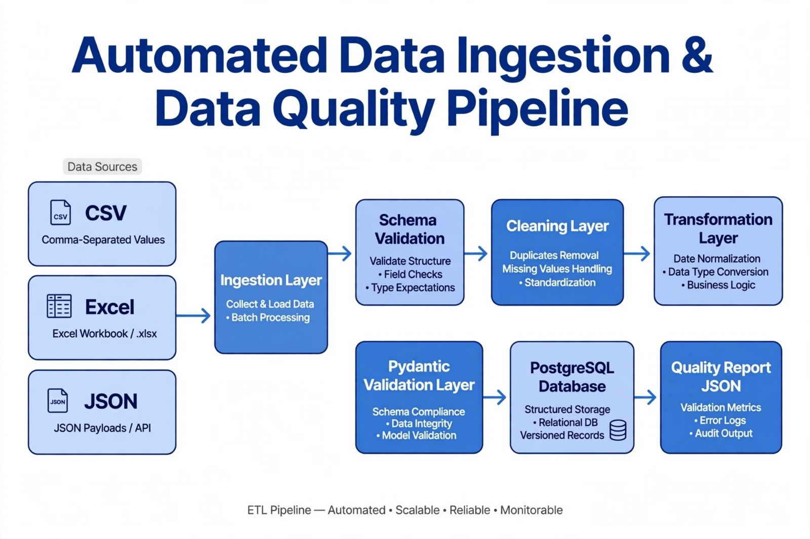

# Automated Data Ingestion & Data Quality Pipeline
Intern: Amna Bibi - Data Engineer Intern - Datalligence - Deadline 19-10-2026

## Overview
Reusable pipeline converting messy CSV/Excel/JSON to clean validated data → PostgreSQL + Quality Report.
# Automated Data Ingestion & Data Quality Pipeline

> ETL Pipeline — Automated • Scalable • Reliable • Monitorable

## Architecture
CSV/Excel/JSON → Ingestion → Schema Validation → Cleaning → Transformation → Pydantic Validation → PostgreSQL → Quality Report (see diagram)

## Setup
python -m venv venv
venv\Scripts\activate (Windows) / source venv/bin/activate (Mac)
pip install -r requirements.txt
python main.py

## How to Add New Dataset (Reusability)
Just add in config.yaml:
datasets:
  employees:
    path: data/raw/employees.csv
    table_name: employees
    required_columns: [emp_id, name]
Then run python main.py - zero code change.

## Features
Ingestion, Schema validation, Field validation (Pydantic), Missing values (median), Duplicates, Data types (to_numeric coerce), Date validation (to_datetime coerce), Transformation, PostgreSQL/SQLite, Quality Report JSON.

## Sample Output
data/clean/customers_clean.csv - 6 valid rows from 10
data/clean/*_report.json - metrics

## Limitations & Future
Batch only now, future: incremental with watermark, Airflow DAG, Great Expectations.

## Explanation
ETL with 6 layers, config-driven reusability, Pydantic for structured errors, batch chosen for simplicity but designed for incremental.
# Data Quality Pipeline 

A production-ready data quality pipeline that ingests, validates, cleans, and transforms data from multiple sources.

## 🚀 Features
- **8-Module Architecture:** ingestion, cleaning, validation, transformation, config, logger, utils, pipeline
- **3 Data Sources:** CSV, JSON, Excel
- **Data Validation:** Quality scores, missing values, duplicates, email validation
- **Cleaning:** Removes duplicates, handles missing values, standardizes dates
- **Logging:** Full pipeline logs saved in `/logs`
- **Reports:** Clean data reports in JSON

## 📁 Project Structure
src/
├── config.py - All paths & settings
├── ingestion.py - Loads CSV, JSON, Excel
├── cleaning.py - Removes duplicates & nulls
├── validation.py - Quality checks
├── transformation.py - Standardizes & merges
├── logger.py - Logging system
├── utils.py - Helper functions
└── pipeline.py - Main orchestrator

##  How to Run
pip install -r requirements.txt
python main.py
## Output
Clean files: data/clean/
Quality reports: data/clean/*_report.json
Logs: logs/
Built by Amna Bibi | Data Engineer Internship Project at Datalligence
